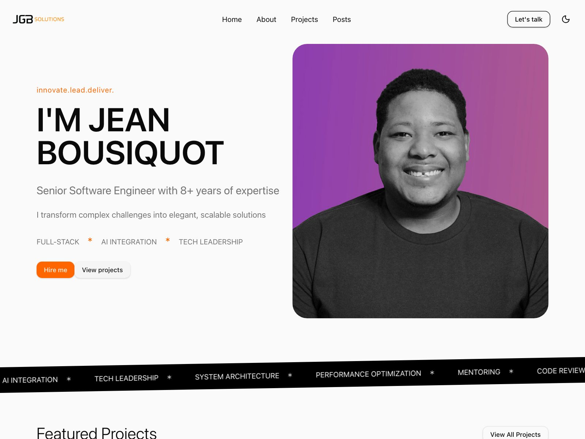
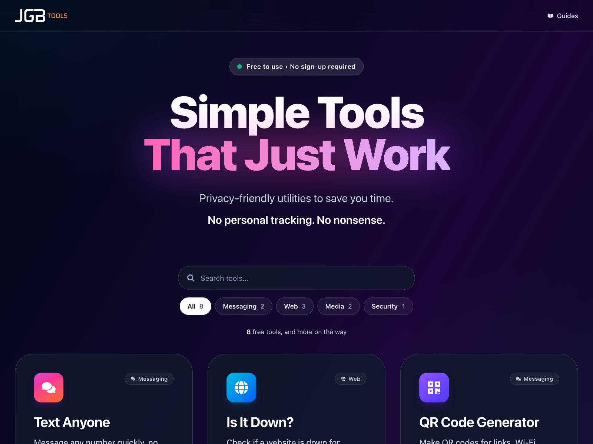
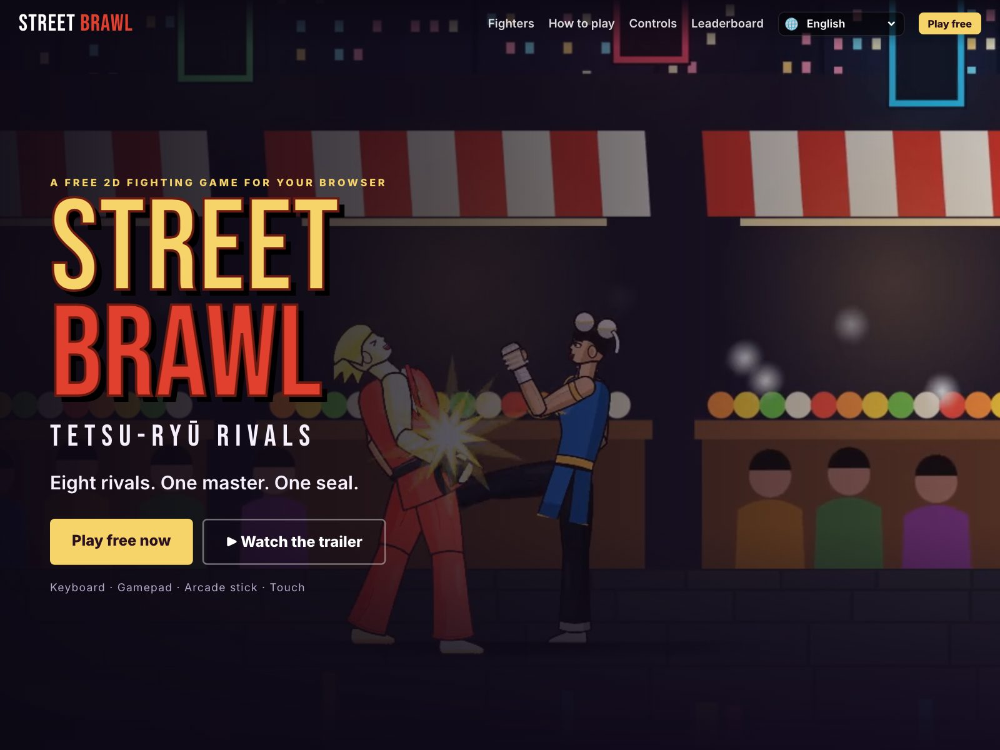
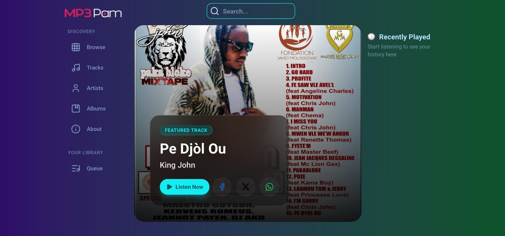
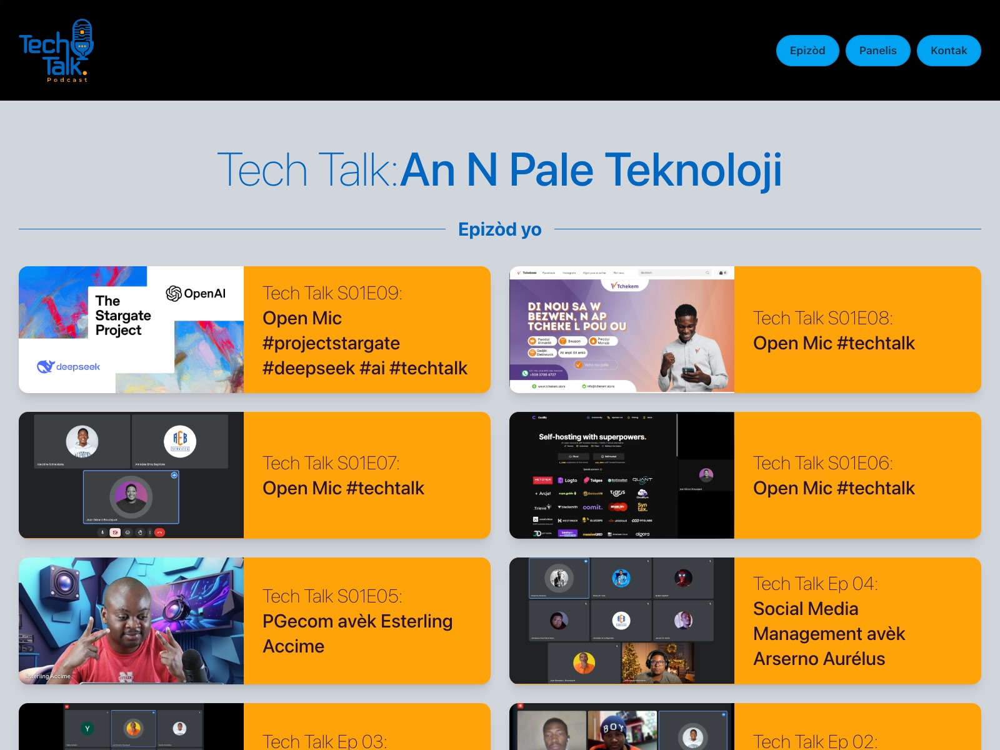
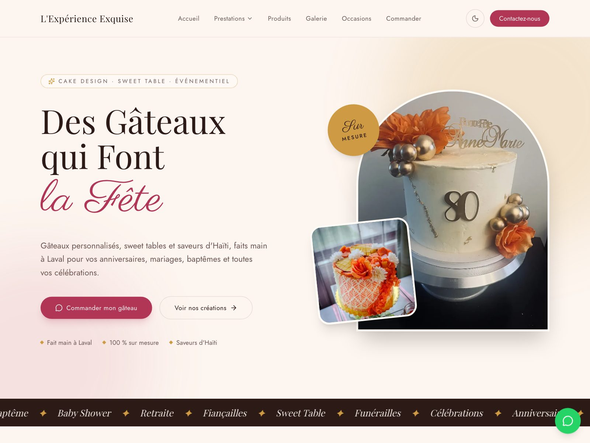
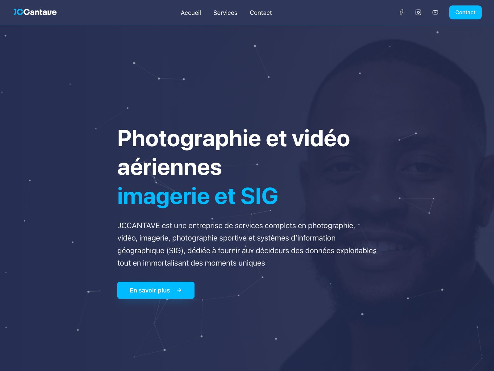
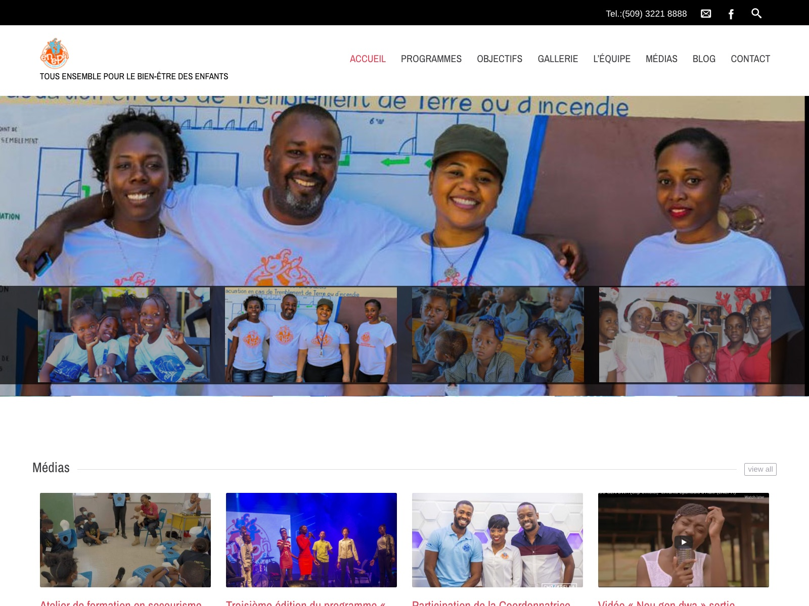

  <a href="https://jgb.solutions">
    <picture>
      <source media="(prefers-color-scheme: dark)" srcset="public/logo-dark.svg" />
      
    </picture>
  </a>

<h3 align="center">Websites, mobile apps and social media for your business.</h3>

  We design, build and run the digital side of your business: 
  a website people trust, an app they keep, and social media that stays active.

  
  

  

  <strong>10+ years</strong> building for the web &nbsp;·&nbsp; <strong>Dozens</strong> of clients and projects &nbsp;·&nbsp; Based in <strong>Laval, Québec</strong>

## What we do

<table>
  <tr>
    <td width="33%" valign="top">
      <h3><a href="https://jgb.solutions/services/websites">Websites</a></h3>
      Custom websites built for speed, clarity and conversion. From landing pages to full web applications, we handle design, development and launch.
        
      Custom design · Mobile-first · E-commerce and booking · Maintenance
    </td>
    <td width="33%" valign="top">
      <h3><a href="https://jgb.solutions/services/mobile-apps">Mobile Apps</a></h3>
      Apps for iOS and Android with thoughtful design and reliable development, whether you need a first version or a production-ready product.
        
      App design · iOS and Android · Prototypes · App store launch
    </td>
    <td width="33%" valign="top">
      <h3><a href="https://jgb.solutions/services/social-media">Social Media</a></h3>
      We manage your social presence so you can focus on running your business, from content planning to posting and engagement.
        
      Content calendar · Posts and scheduling · Community · Monthly reports
    </td>
  </tr>
</table>

<em>Every project starts with a call and a clear quote.</em>

## Our products

We don't just build for clients. We build and run our own apps, games and media sites, and they're free to use.

<table>
  <tr>
    <td width="50%" valign="top">
      
      <h3><a href="https://tools.jgb.solutions">JGB Tools</a></h3>
      Free online tools for everyday tasks, with no sign-up and no personal tracking.
    </td>
    <td width="50%" valign="top">
      
      <h3><a href="https://streetbrawl.jgb.solutions">Street Brawl</a></h3>
      A free 2D fighting game in your browser, with story, training and online modes.
    </td>
  </tr>
  <tr>
    <td width="50%" valign="top">
      
      <h3><a href="https://mp3pam.top">MP3PAM</a></h3>
      A free platform for sharing music, podcasts and audio.
    </td>
    <td width="50%" valign="top">
      
      <h3><a href="https://techtalk.jgb.solutions">Tech Talk</a></h3>
      A tech podcast in Haitian Creole, with episodes, articles and discussions.
    </td>
  </tr>
</table>

## Recent work

<table>
  <tr>
    <td width="33%" valign="top">
      
       <strong><a href="https://jgb.solutions/projects/experience-exquise">L'Expérience Exquise</a></strong>
       Cakes, catering and events in Laval
    </td>
    <td width="33%" valign="top">
      
       <strong><a href="https://jgb.solutions/projects/jc-cantave">JC Cantave</a></strong>
       Photography and GIS
    </td>
    <td width="33%" valign="top">
      
       <strong><a href="https://jgb.solutions/projects/eneph">ENEPH</a></strong>
       A non-profit for children
    </td>
  </tr>
</table>

<a href="https://jgb.solutions/projects">See all our work →</a>

## How we work

| 01 · Discovery                                                                    | 02 · Design                                                    | 03 · Build                                           | 04 · Launch & support                                     |
| --------------------------------------------------------------------------------- | -------------------------------------------------------------- | ---------------------------------------------------- | --------------------------------------------------------- |
| A call about your business, your customers and what you need. Then a clear quote. | We design the pages or screens and refine them with you first. | Fast, mobile-first and easy for your team to update. | We put it live, show you how it works and stay available. |

## Need an extra engineer?

Besides full projects, we also work inside your team on contract. Add a senior engineer with **10+ years** of experience to your product, for a few weeks or a few months: TypeScript and React front to back, web and mobile apps, performance and architecture, code reviews and mentoring.

<a href="https://jgb.solutions/services#contract-work">More about contract work →</a>

---

<h3 align="center">Have a project in mind?</h3>

  Tell us what you need and we'll get back to you with a quote.

  
  

© JGB Solutions · Laval, Québec · <a href="https://jgb.solutions">jgb.solutions</a>

