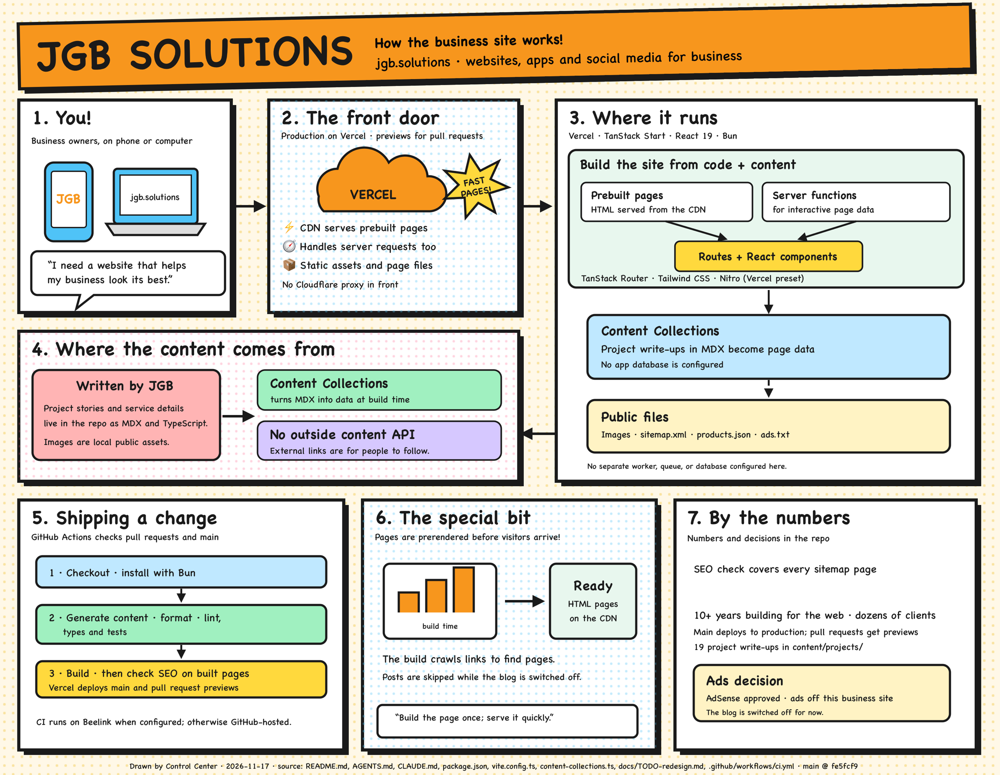

# jgb.solutions architecture

A one-page, comic-style map of how jgb.solutions runs: who uses it, the front door, where it runs and its data
stores, where its data comes from, shipping a change, its special part, and key numbers. Drawn on
2026-11-17 from this repo's main branch (sources are in the picture's footer). When the setup changes,
update the SVG, then render the PNG again.

- `jgb-solutions-architecture.svg`: the source (hand-written SVG, edit this one).
- `jgb-solutions-architecture.png`: the picture, rendered from the SVG.

## Render the PNG (macOS)

Quick Look renders SVGs as squares, so render a centered square copy, then crop it. Musivo's
`architecture/README.md` has the commands; for this file the canvas is `viewBox="0 0 1600 1240"`.

The fonts are Chalkboard SE (macOS), with Comic Sans MS as the fallback.
